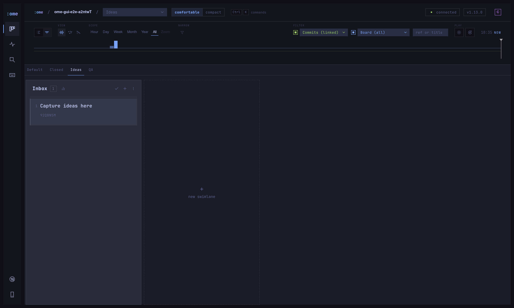
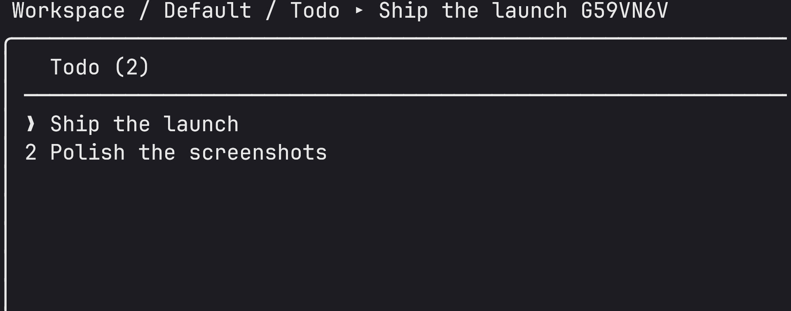
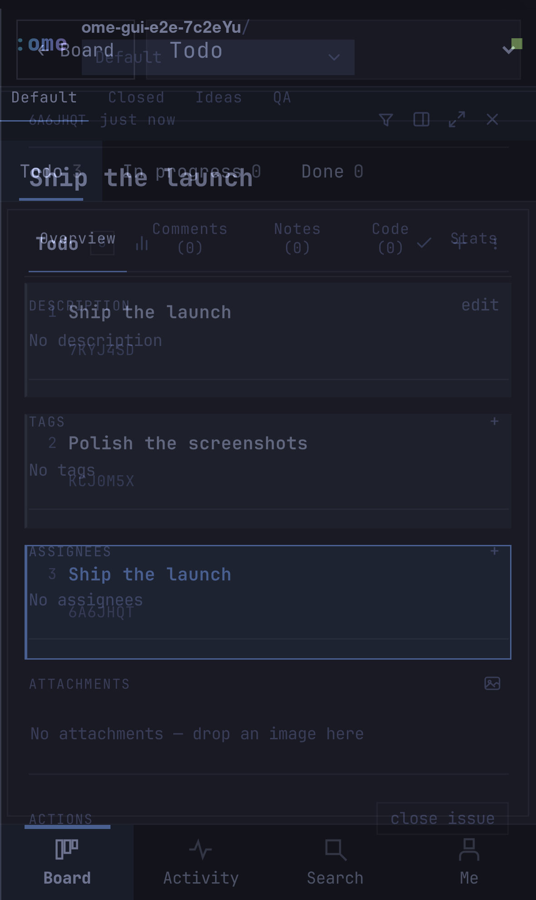
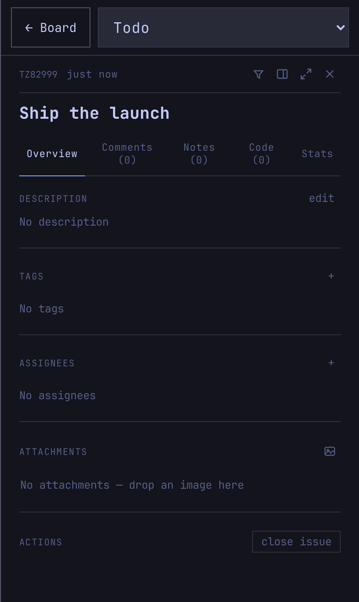
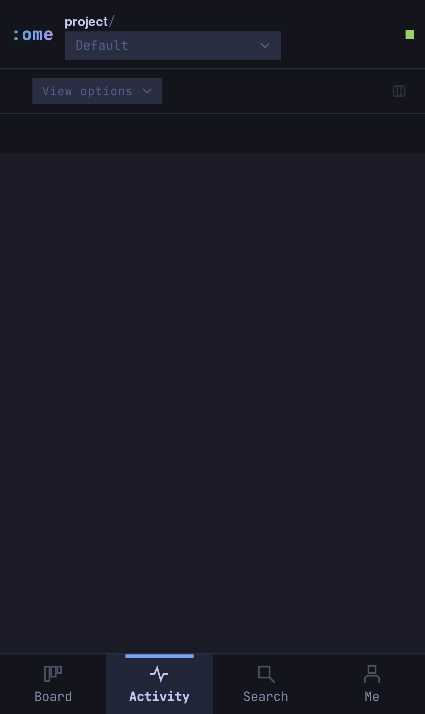
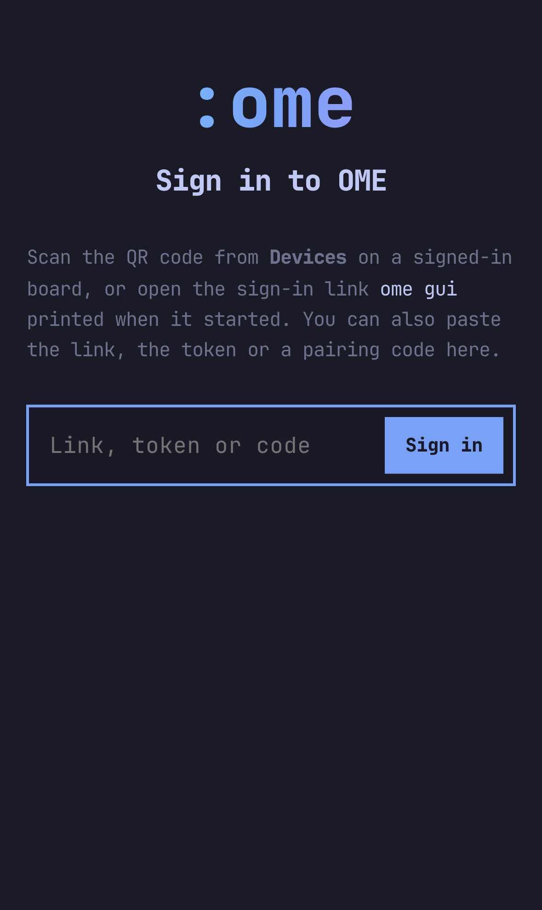
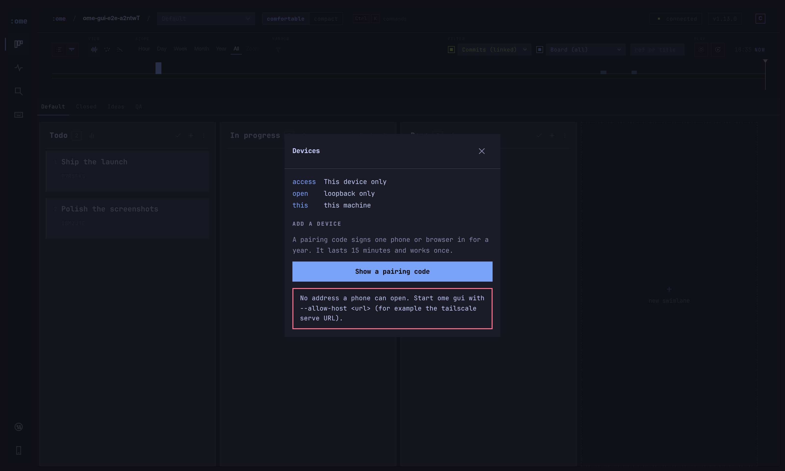

# Oh-My-Epiq

> **The Epiq you love, with batteries included.**

Oh-My-Epiq (**OME**) is a local-first, Git-backed issue board with four faces —
a **CLI** (`ome`), a **terminal UI**, a **browser board** (`ome gui`) and an
**agent MCP server** (`ome-mcp`). It is a hard fork of
[Epiq](https://github.com/ljtn/epiq) by [@ljtn](https://github.com/ljtn):
the same engine, the same event model, the same interfaces, with the operator
and agent tooling we wanted layered on top.

State is an immutable, append-only event log, versioned and synchronized over
Git. No accounts, no SaaS, no database. Your board lives next to your code and
travels with it.



## Batteries included

Every upstream Epiq feature, plus the operator and agent surface:

- **Four surfaces, one state** — CLI, TUI, browser board and MCP all read and
  write the same event log, so an agent's change shows up on your board
  instantly.
- **A migration from Epiq** — `ome migrate` renames the on-disk surface
  (`~/.epiq-global` → `~/.ome-global`, `.epiq/` → `.ome/`, `__epiq_state__` →
  `__ome_state__`) with a dry run, a backup and a printed rollback. Dry-run
  first; see [Coming from Epiq?](#coming-from-epiq).
- **A clean agent MCP** — every tool that writes takes a full id _or_ a 7-char
  `ref`; adding a tag or an assignee a ticket already has is an idempotent
  no-op; removals accept a name; errors say what to pass. The footguns and the
  four admin tools agents never call are pruned from the surface.
- **The Oh-My-Pocket look** — the browser board wears the same shell as
  [Oh-My-Pocket](https://github.com/T-Crypt/oh-my-pocket): the Tokyo Night
  palette, square tiles, 2px window borders with Hyprland's gaps, no glow, a
  rail of icon tiles and bundled JetBrains Mono everywhere. The agent harness
  and the board read as one family, on the desktop and on the phone.
- **The board on your phone** — under 760px wide the GUI turns into a phone
  app: one lane per screen, a ticket as a full-screen sheet with a lane
  picker, the event log as its own tab, and search through the command
  palette. Add it to the home screen and it runs standalone. See
  [Remote and mobile](#remote-and-mobile).
- **Remote access, signed in** — `ome gui --access lan|tailscale|cloudflare`
  or `--allow-host` behind a proxy such as `tailscale serve`. Anything that is
  not this machine's own browser needs the owner token, and a phone signs in
  by scanning a single-use pairing code.
- **The MCP server is all an agent needs** — it sends the board workflow
  (take an identity, sync on demand, keep tickets current) to every client on
  connect, so a project carries no agent files. A longer written skill is
  offered at `skills/ome/SKILL.md` for anyone who wants it.



## What OME adds over Epiq

The engine is Epiq's; the operator and agent surface on top is OME's. In one
glance, what this fork adds:

- **A migration, not a re-install** — `ome migrate` carries an existing Epiq
  board to OME's on-disk layout with a dry run, a backup and a printed
  rollback.
- **A pruned, forgiving agent MCP** — every writing tool takes a full id or a
  7-char ref, adding something a ticket already has is an idempotent no-op,
  removals accept a name, and the admin tools agents never call are gone from
  the surface. The board workflow ships to every connected client, so a project
  carries no agent files.
- **The Oh-My-Pocket look, desktop and phone** — the browser board wears the
  Oh-My-Pocket shell (Tokyo Night palette, square tiles, icon rail) and turns
  into a standalone phone app under 760px, with signed-in remote access over
  LAN, Tailscale or Cloudflare — Epiq's GUI has neither the shell nor the
  sign-in.

## Roadmap

The fork ships the engine and the agent surface first. These operator features
are designed and tracked but **not implemented yet**:

- **Global portfolio board** — every project's tickets in one view, across
  boards, with the active project highlighted.
- **Lifecycle status** — an explicit, ordered phase
  (`idea · planned · in-flight · maintenance-staged · maintenance-done ·
support · parked`) that drives a status view on the board.
- **Notes and priority boards** — capture loose thoughts and rank work P0–P3
  without fighting the ticket schema.
- **Instructions on a ticket** — a structured "what to do" block, distinct from
  the description and the comment thread, so handoff to an agent is
  unambiguous.
- **New-project creation from the WebUI** — point the board at a repo and go,
  without dropping to the TUI for `:init`.
- **Push notifications and offline use on the phone** — Oh-My-Pocket's service
  worker is not ported yet; the phone app needs the server reachable.

The description in this README is the system of record for what ships; the
roadmap above is the honest list of what does not.

## What it inherits from Epiq

- **Workflow replay** — rewind the board and watch what happened while you were
  away, as if it were happening now.
- **Code linked to tickets** — prefix a commit subject with a ticket's `ref`
  and the diff shows up on the ticket. Comment on selected lines; file a ticket
  straight from a selection.
- **Event-sourced, conflict-light state** — append-only per-user logs merged
  deterministically, so concurrent work converges.
- **Repo-native, offline-friendly, fast, portable, command driven.**

## Install

OME is not published to npm yet, and a direct
`npm install --global git+https://github.com/T-Crypt/oh-my-epiq.git` **does not
work**: the build runs on `prepack`, while a Git install runs `prepare` (which
only sets up husky), so the `dist/` the package needs is never produced.
Install from a clone or a packed tarball instead.

From a clone — builds `dist/`, then links the bins:

```bash
git clone https://github.com/T-Crypt/oh-my-epiq.git
cd oh-my-epiq
npm install
npm run build:npm
npm link          # exposes `ome` and `ome-mcp`
```

From a packed tarball — `npm pack` runs the build, then install it under a
pinned prefix:

```bash
npm pack          # writes oh-my-epiq-<version>.tgz and runs the build
npm install -g --prefix ~/.local/share/ome-mcp-npm ./oh-my-epiq-*.tgz
# ~/.local/share/ome-mcp-npm/bin/{ome,ome-mcp}
```

Verify:

```bash
ome --version
```

## Getting started

Inside any Git repository:

```bash
ome
```

First run opens the interactive setup wizard. That is it.

Launch the browser board with:

```bash
ome gui
```

On a machine with no display, or with `--no-open`, it serves without opening a
browser; open the URL it prints. Without a terminal attached it also stays shut,
so a script or an agent driving it never takes your desktop; `OME_GUI_OPEN=1`
opens one anyway (a keybind has no terminal), and `OME_GUI_NO_OPEN=1` never
opens one whatever else is set. The board serves on loopback by default
(port 3710). To open it from a phone or another machine, see
[Remote and mobile](#remote-and-mobile).

> Setup writes your user config to `~/.ome-global/config.json`.
>
> Initialization creates:
>
> - Project definition in `./.ome/project.json`
> - Authoritative Git state at `~/.ome-global/worktrees/<id>` (branch
>   `__ome_state__`)
> - A `.gitignore` entry for local-only `.ome/log/`
> - A local debug log at `.ome/log/ome.log`

Act as somebody other than the configured user (for an agent or a second
operator):

```bash
ome --as claude
```

## Remote and mobile

The browser board works from a phone. It uses the same access model as
Oh-My-Pocket: pick how the board is reached, and sign each device in once.

<p>




</p>

| Access            | Command                                                 | Who can reach it                                                                                                 |
| ----------------- | ------------------------------------------------------- | ---------------------------------------------------------------------------------------------------------------- |
| This device only  | `ome gui`                                               | Loopback. The default, as before                                                                                 |
| Behind a proxy    | `ome gui --allow-host https://host.example.ts.net:3710` | Whoever the proxy lets in. Use this with `tailscale serve`                                                       |
| Local network     | `ome gui --access lan`                                  | The machine's own LAN address, never every interface                                                             |
| Tailscale         | `ome gui --access tailscale`                            | The machine's tailnet address, plain http                                                                        |
| Cloudflare Tunnel | `ome gui --access cloudflare`                           | Anyone with the `trycloudflare.com` URL. Needs `cloudflared` on PATH. Public, so only the token stands behind it |

`--allow-host` takes a bare name or the URL a browser opens, and can repeat.
`OME_GUI_ALLOW_HOSTS` (comma-separated) does the same from a service unit, and
`OME_GUI_PORT` sets the port.

The recommended setup on a tailnet keeps the board on loopback and lets
Tailscale terminate TLS:

```bash
OME_GUI_PORT=3710 ome gui --no-open --allow-host https://<machine>.<tailnet>.ts.net:3710
sudo tailscale serve --bg --https=3710 http://127.0.0.1:3710
```

**Signing in.** The first time the board is reached from anywhere but its own
machine, it shows a sign-in page. There are two ways in:

- **Pair a phone.** On a signed-in board, open **Devices** (the phone icon at
  the bottom of the rail, or **Me** on a phone) and tap **Show a pairing
  code**. Scan the QR code with the phone's camera. The code lasts 15 minutes
  and works once.
- **Use the sign-in link.** When the board answers to more than loopback,
  `ome gui` prints `https://…/login?token=…` and its QR code at startup. That
  link is the owner token: treat it as a password.

A signed-in browser keeps an `HttpOnly` cookie for a year. `ome gui
--rotate-token` replaces the token and signs every device out. The token lives
in `~/.ome-global/gui-access.json` (mode 600).



**What is checked.** A request is this machine's own browser only when it
arrives on a loopback socket, names a loopback host, and carries no forwarding
header. A proxy on the same machine still counts as remote. A request naming a
host the server was not told about is refused before any route, which stops
DNS rebinding. Writes and the live socket must also come from a page this
server served: the old loopback rule, or an allowed host whose origin matches
the request. A page on another port of the same machine is refused even though
it shares the cookie.

**On the phone.** Drag and drop does not work on a touch screen, so a ticket's
sheet has a lane picker. The command palette has a new **Move ticket to a
lane** command (`move`, as in the TUI), which works on the desktop too.
Everything else is the same board: the same tabs, comments, tags, assignees,
attachments, linked commits and history.

## Coming from Epiq?

OME renames the on-disk surface, so point it at your existing boards once:

```bash
ome migrate            # plan only — changes nothing
ome migrate --apply    # back up, rename, move the state branch, verify
```

The migration backs up `~/.epiq-global`, creates `__ome_state__` at the same
commit as `__epiq_state__`, rewrites `.epiq/` → `.ome/` and
`~/.epiq-global/` → `~/.ome-global/`, and prints a rollback. Environment
variables were renamed too (`EPIQ_*` → `OME_*`); the old names are still read
with a deprecation warning. A half-migrated board still reads: diff comments
accept legacy `epiq-` markers and commit refs accept both `[epiq:` and `[ome:`.

`ome migrate` is a one-way door. Always run the dry run first, and never run
`--apply` against a board you have not named.

## MCP for agents

OME ships an MCP server, `ome-mcp`, speaking stdio. Register it with Claude
Code:

```bash
claude mcp add --scope user ome -- /absolute/path/to/ome-mcp
```

For hand-edited clients:

```json
{
	"mcpServers": {
		"ome": {
			"command": "/absolute/path/to/ome-mcp"
		}
	}
}
```

Tools are namespaced `ome_*` (`ome_issue_create`, `ome_issue_move`,
`ome_board_list`, …). Every write accepts a ticket by full id or by `ref`.
`ome_sync` is the only tool that touches the network; sync is on demand. Take
an identity (`ome_actor_assume`, `provider/name`) before your first write.

The server sends the board workflow as its MCP instructions, so nothing has to
be installed in a project. The longer written skill is optional: it lives at
`skills/ome/SKILL.md`, and `ome_skill_install` copies it into one clone at
`.claude/skills/ome/SKILL.md` and lists it in `.git/info/exclude`, so it is
never committed. See `CONTRIBUTING.md`.

## How state is synchronized

OME uses Git in the background — no manual Git commands. `ome` writes to an
append-only event log on a dedicated state branch (`__ome_state__`) via a Git
worktree, isolated from your working tree. Running `:sync` (or `ome sync`)
merges and publishes. Project metadata lives in `.ome/project.json`.

Events use time-sortable ULIDs plus an edge reference to the last known event,
so concurrent edits converge deterministically and merges stay trivial.

## Credit

Oh-My-Epiq is a fork of [Epiq](https://github.com/ljtn/epiq) by
[@ljtn](https://github.com/ljtn). The engine, the event model and the original
design are his. If this is useful, go star the upstream. See
[UPSTREAM.md](UPSTREAM.md) for the full fork relationship.

MIT licensed — see [LICENSE](LICENSE). The shell's look follows
[Pi Pocket](https://github.com/TannerMidd/pi-pocket) by Tanner Middleton, through
the Oh-My-Pocket fork. JetBrains Mono is bundled under the
[SIL Open Font License](source/gui/JetBrainsMono-OFL.txt).

Never leave your editor.
